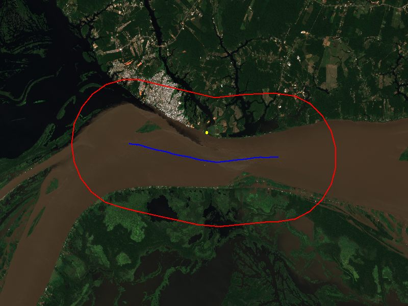
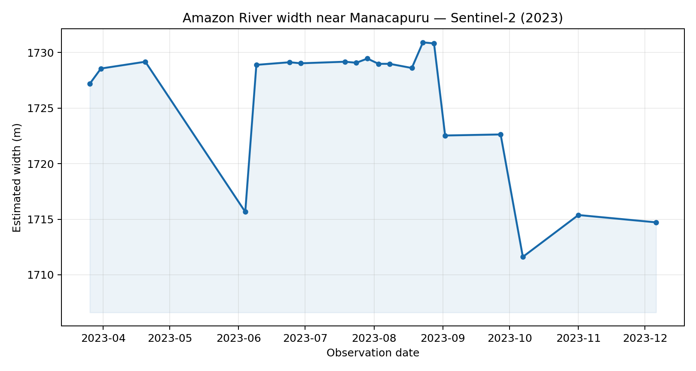

# Sentinel-2 example: Amazon River near Manacapuru

This folder contains one example produced with `RiWEx_Sentinel2.py`. The point lies on the Amazon River near Manacapuru, Brazil.

| Setting | Value |
| --- | --- |
| Latitude, longitude | `-3.312`, `-60.598` |
| Study period | 2023-01-01 to 2024-01-01 (end date excluded) |
| Water index | NDWI |
| Lambda | 1 |
| SWORD reach ID | 62291000111 |
| Usable Sentinel-2 observations | 20 |

The workflow estimated widths between 1,711.6 and 1,730.9 metres, with a mean of 1,725.5 metres. The number of observations is lower than the number of Sentinel-2 acquisitions because the script filters clouds and images without usable data.



The yellow point is the supplied coordinate, the blue line is the selected SWORD reach, and the red outline is the working buffer.



`widths_ndwi.csv` is the direct width-table output from the script. The first five lines record the site and reach metadata; the table begins on line 6.

The command used for this run was:

```bash
python RiWEx_Sentinel2.py \
  --site Amazon_Manacapuru \
  --latitude -3.312 \
  --longitude -60.598 \
  --start-date 2023-01-01 \
  --end-date 2024-01-01 \
  --indices ndwi \
  --lambdas 1 \
  --project-id YOUR_PROJECT_ID
```

This example shows the format of a RiWEx result. It has not been compared with a same-date field measurement, so it should not be read as an accuracy claim.
